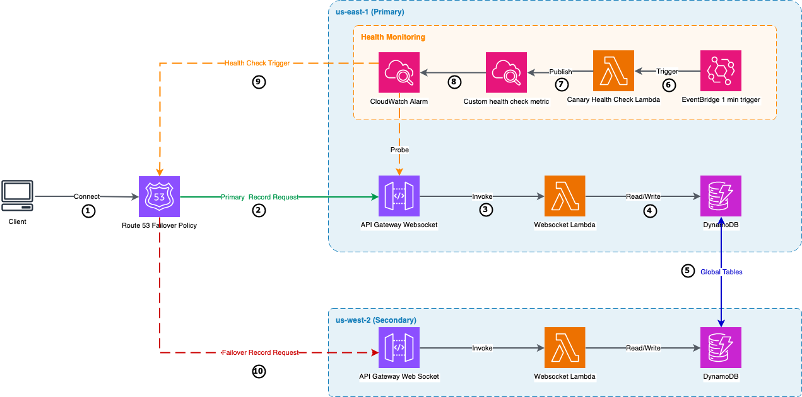

# Multi-region disaster recovery for Amazon API Gateway WebSocket APIs

Multi-region disaster recovery for API Gateway WebSocket APIs using a real-time auction application. When the primary Region fails, clients automatically reconnect to the secondary Region and recover state — no manual intervention needed.

## Architecture



**Services used:** Amazon API Gateway (WebSocket APIs), AWS Lambda, Amazon DynamoDB global tables, Amazon Route 53, Amazon CloudWatch, Amazon EventBridge

## How it works

**Normal operation:** Users connect to a single domain name. Behind the scenes, Route 53 routes them to the primary Region. As they interact with the app, their state is continuously replicated to the secondary Region via Amazon DynamoDB global tables.

**Failure detection:** A canary Lambda probes the WebSocket endpoint every minute by connecting, sending a heartbeat, and confirming a response. If the endpoint stops responding, a CloudWatch alarm fires and Route 53 marks the primary as unhealthy.

**Failover:** Route 53 shifts DNS to the secondary Region. Clients detect the broken connection within about 35 seconds through heartbeat timeout, reconnect with exponential backoff and jitter, and recover their state from the secondary Region's Amazon DynamoDB replica. From the user's perspective, the app briefly pauses and resumes. The Region change is visible in the UI but requires no action.

**Failback:** When the primary recovers, the canary confirms it's healthy again. The alarm clears, Route 53 shifts DNS back, and clients reconnect to the primary through the same automatic process.

## Getting started

### Prerequisites

- AWS account with appropriate permissions
- Domain name managed in Route 53
- AWS Certificate Manager (ACM) certificates for your domain in both us-east-1 and us-west-2
- AWS CLI configured
- Node.js installed

### Step 1: Deploy backend

```bash
./deploy.sh
```

Deploys to both Regions:
- `counter-template.yaml` → WebSocket API, Lambda, Amazon DynamoDB global tables
- `health-check.yaml` → Canary Lambda, EventBridge schedule, CloudWatch alarm, Route 53 health checks (us-east-1 only)

### Step 2: Set up custom domains

Create an API Gateway custom domain in each Region, mapping it to your WebSocket API's `prod` stage. Use the same domain name in both Regions.

See [Setting up custom domain names for WebSocket APIs](https://docs.aws.amazon.com/apigateway/latest/developerguide/websocket-api-custom-domain-names.html).

### Step 3: Configure DNS failover

Create two A (Alias) records in your Route 53 hosted zone:

| | Primary record | Secondary record |
|---|---|---|
| Routing policy | Failover – Primary | Failover – Secondary |
| Alias target | Custom domain in us-east-1 | Custom domain in us-west-2 |
| Health check | From `deploy.sh` output | None |

The secondary has no health check — Route 53 treats it as always healthy, making it the automatic fallback.

```bash
# Get the health check ID
aws cloudformation describe-stacks \
  --stack-name websocket-health-check \
  --region us-east-1 \
  --query 'Stacks[0].Outputs[?OutputKey==`HealthCheckId`].OutputValue' \
  --output text
```

### Step 4: Run the client

```bash
cd client
cp .env.example .env.local
# Edit .env.local with your custom domain URL
npm install
npm run dev
```

## Testing failover

1. Connect the client — note the serving Region (US-EAST-1)
2. Trigger failover by disabling the primary Lambda:
   ```bash
   aws lambda put-function-concurrency \
     --function-name counter-handler-us-east-1 \
     --reserved-concurrent-executions 0 \
     --region us-east-1
   ```
3. Wait ~2 minutes for the canary to detect the failure and Route 53 DNS to shift
4. Client reconnects automatically — serving Region flips to US-WEST-2
5. Auction state is preserved via Amazon DynamoDB global tables
6. Restore the primary (triggers automatic failback):
   ```bash
   aws lambda delete-function-concurrency \
     --function-name counter-handler-us-east-1 \
     --region us-east-1
   ```
7. Wait ~3 minutes for the canary to confirm recovery — traffic shifts back to US-EAST-1

## Project structure

```
cloudformation/
  counter-template.yaml       WebSocket API, Lambda, Amazon DynamoDB global tables
  health-check.yaml           Canary Lambda, EventBridge schedule, CloudWatch alarm, Route 53 health checks
lambda/
  counter-lambda.py           Lambda handler (all WebSocket routes)
  canary-lambda.py            Health probe (connects, heartbeats, publishes metric)
client/                       React + TypeScript client (Vite)
  src/config.ts               WebSocket endpoint configuration (reads from .env.local)
  src/App.tsx                 Auction UI
  src/hooks/useFailoverWebSocket.ts   Auto-reconnect + heartbeat hook
docs/
  websocket-failover-architecture.png   Architecture diagram
deploy.sh                     One-command deployment
```

## Cleanup

```bash
aws cloudformation delete-stack --stack-name websocket-health-check --region us-east-1
aws cloudformation delete-stack --stack-name websocket-counter-secondary --region us-west-2
aws cloudformation delete-stack --stack-name websocket-counter-primary --region us-east-1
```

Also delete Route 53 failover records and API Gateway custom domains manually.

## Cost

Estimated under $5/month with light usage. Main costs: Amazon DynamoDB global tables (per request + replication), API Gateway ($1/million connection minutes), Route 53 health check (approximately $0.75/month), canary Lambda (approximately $0.01/month).
